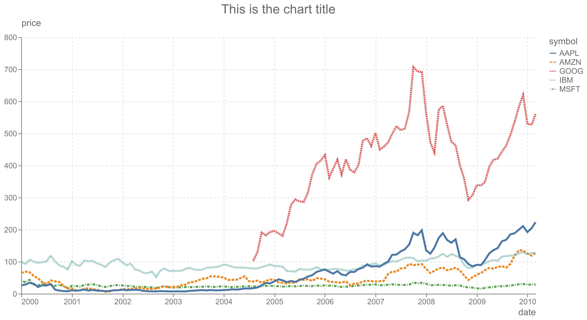
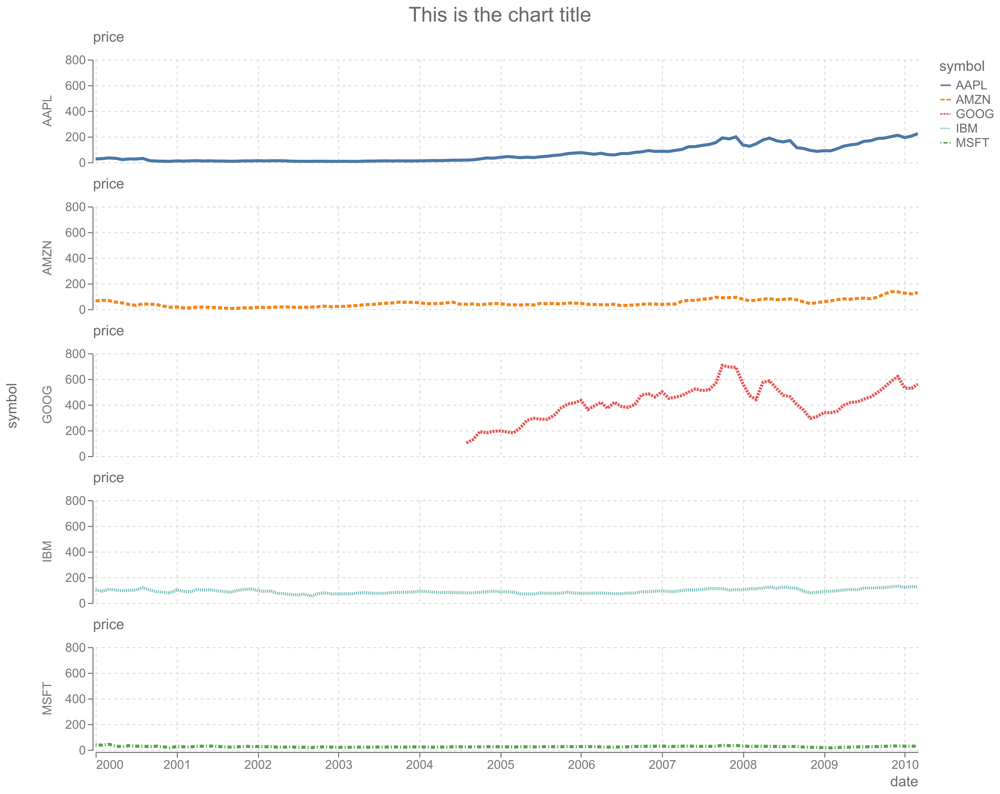

# camminady_altair_theme

A minimal Altair theme.

## Installation

```bash
pip install camminady_altair_theme
```

## Usage

```python
import camminady_altair_theme  # registers and enables the theme automatically
```

The theme is registered with `enable=True`, so importing the package is all you need — no `alt.theme.enable()` call required and no linter `# noqa` comments.

## Examples

A simple chart.


And a faceted version.

